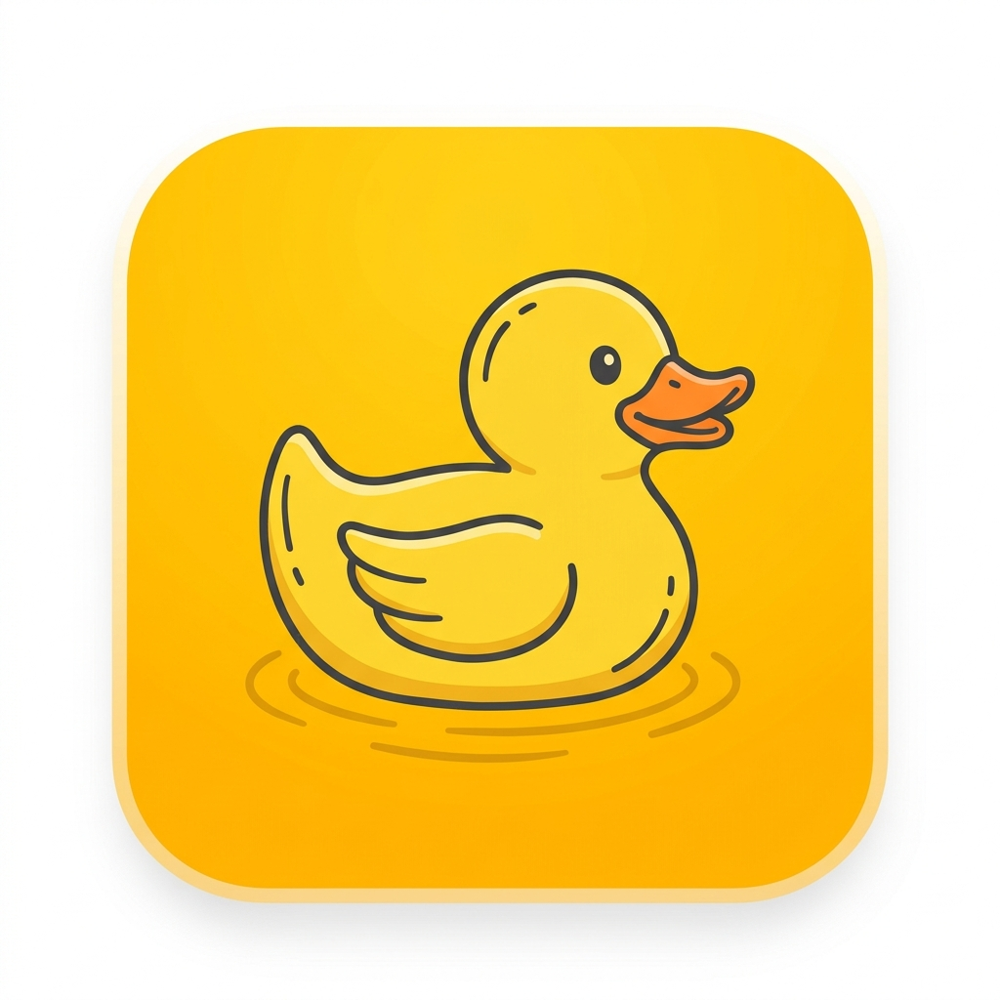

# DoodleChat 🦆✨

A privacy-centric, turn-based ephemeral doodle messenger built with Flutter and Node.js.



## 🌟 Key Features

- 🎨 **Pure Handwritten Doodles**: Smooth 60fps freehand drawing engine using `perfect_freehand` with dual-layer committed/live canvas rendering.
- 🧽 **The Golden Turn Rule**: Only one doodle can be in flight at a time. The recipient must completely erase the doodle before either party can send the next response.
- ⚡ **Realtime Two-Way Sync**:
  - Live drawing indicators (`✏️ doodling right now...`).
  - Realtime erase progress (`X is erasing... 42%`) with stroke-length tracking and crumb auto-sweep.
  - Confetti burst & sender canvas unlock upon completion.
- ✍️ **Handwritten Text & Voice Conversion**: Type or speak to stamp handwritten-style text (`Patrick Hand`, `Gaegu`, `Caveat`) directly onto the canvas.
- 🛡️ **Privacy-Centric**: Ephemeral zero-trace message relay, dynamic watermark protection against screenshots and screen recordings.
- 👥 **Frictionless Friend Discovery**:
  - Live online peers list.
  - QR Code generator and mobile camera scanner.
  - Unique `@handle` deep linking (`doodlechat://user/<username>`).
- 🌓 **Rich Aesthetics**: Custom toy-duck brand identity, dynamic dark/light themes, and Cupertino page transitions.

---

## 🏗️ Architecture

```
DoodleChat/
├── lib/
│   ├── models/
│   │   ├── doodle_stroke.dart      # Normalized virtual canvas (1000x1000) stroke data
│   │   ├── chat_contact.dart       # Contact & status models (receivedMustErase, sentWaitingForErase)
│   │   └── user_profile.dart       # User profile, theme, and QR data
│   ├── services/
│   │   ├── doodle_controller.dart  # Canvas state, erase mechanics, and repaint ticks
│   │   └── chat_service.dart       # WebSocket realtime client, reconnect & state sync
│   ├── screens/
│   │   ├── splash_screen.dart      # Animated "HI" with cat whiskers
│   │   ├── auth_screen.dart        # Unique handle & avatar setup
│   │   ├── onboarding_screen.dart  # Golden rule & privacy guide
│   │   ├── home_screen.dart        # Conversations, status, and quick-draw
│   │   ├── chat_screen.dart        # Canvas, presence, mic, text, and eraser
│   │   └── profile_screen.dart     # QR code sharing, settings & privacy
│   ├── widgets/
│   │   ├── doodle_canvas.dart      # Optimized 2-layer CustomPainter canvas
│   │   ├── find_friends_sheet.dart # QR scanner & handle finder
│   │   └── cat_whiskers_hi.dart    # Signature animated doodle
│   └── theme/
│       └── app_theme.dart          # Palette & typography tokens
└── server/
    └── relay.js                    # Node.js WebSocket + static web server
```

---

## 🚀 Getting Started

### Prerequisites

- [Flutter SDK](https://docs.flutter.dev/get-started/install) (3.24+)
- [Node.js](https://nodejs.org/) (v18+)

### 1. Start the Relay Server

```bash
cd server
npm install
node relay.js
```
The server will run on `http://0.0.0.0:8080` with unified HTTP static serving and WebSocket signaling.

### 2. Run the Flutter App

For local testing on Web:
```bash
flutter build web --release
# Server automatically serves build/web at http://localhost:8080
```

For iOS / Android:
```bash
flutter run
```

---

## 📄 License

MIT License. Designed and built with ❤️ by Akshit Upadhyay.
